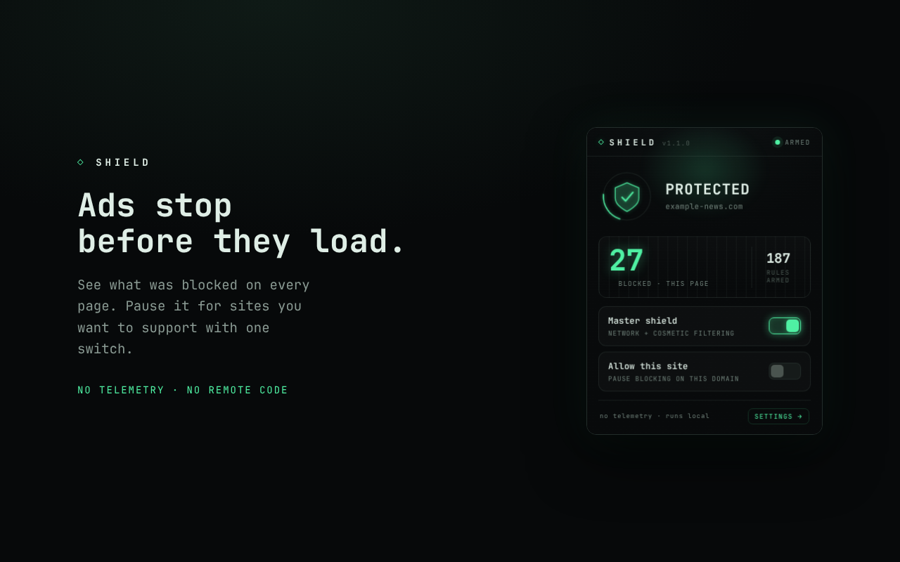

# Shield AdBlocker

[](https://github.com/ROHITCRAFTSYT/shield-adblocker/actions/workflows/ci.yml)
[](LICENSE)

A small, private **Manifest V3** ad and tracker blocker for Chromium browsers
(Chrome, Edge, Brave, Opera). It blocks ad and tracker requests at the
**network layer** with `declarativeNetRequest` and hides the empty slots they
leave behind with **cosmetic filtering**. It uses three permissions, runs no
remote code, and collects no data.

<p align="center">
  
</p>

## Features

- **Network blocking** of 187 well-known ad and tracker endpoints (Google ad
  and analytics services, Amazon and Microsoft ad systems, the major
  exchanges, Taboola/Outbrain, social pixels, session-replay and analytics
  tools). Third-party only, so a tracker's own website keeps working.
- **Cosmetic filtering**: generic ad-slot selectors plus tuned rules for
  YouTube, Reddit, LinkedIn, X and Facebook.
- **Per-site allowlist**: one switch in the popup, or manage the full list,
  with bulk import and export, on the settings page. Allowlisting covers the
  whole page, including third-party frames.
- **Blocked-on-this-page counter**, from Chrome's own match log.
- **Global on/off** switch, mirrored on the toolbar badge.
- **Private by design**: no telemetry, no network requests of its own,
  settings stored only in this browser. See [PRIVACY.md](PRIVACY.md).

## Install

**From source (developer mode):**

1. Download or clone this repository.
2. Open `chrome://extensions` (or `edge://extensions`, `brave://extensions`).
3. Turn on **Developer mode** and click **Load unpacked**.
4. Select the folder that contains `manifest.json`.

Step-by-step notes and troubleshooting: [docs/INSTALL.md](docs/INSTALL.md).

## Using it

| Where | Control | What it does |
| --- | --- | --- |
| Popup | **Master shield** | Turns all network and cosmetic filtering on or off. |
| Popup | **Allow this site** | Pauses blocking on the current site and its subdomains. Reload the page to apply (the popup offers a button). |
| Popup | **blocked · this page** | Requests blocked on the active tab. |
| Popup | **rules armed** | Rules in the bundled blocklist. |
| Settings | **Allowlist** | Add a site (a bare domain or any page URL), remove one, clear all, or bulk edit the list one site per line. |

Open the settings page from the popup (**settings →**) or from the
extension's **Details → Extension options**.

## Permissions

| Permission | Why it is needed |
| --- | --- |
| `declarativeNetRequest` | Block ad and tracker requests with the bundled rules, and apply the allowlist. Chrome evaluates the rules itself; the extension never sees request contents. |
| `storage` | Save the on/off switch and the allowlist in this browser. |
| `activeTab` | When you open the popup, read the current tab's address (to show and allowlist the site) and its blocked-request count. |
| Content script on `http://*/*` and `https://*/*` | Inject the CSS that hides leftover ad slots. |

At install, Chrome shows **"Read and change all your data on all websites"**.
The content script causes that warning: any extension that styles pages on
every site gets it. The extension does not read page content, and it has no
host permissions, so it cannot fetch from sites or run scripts in them.

Removed in 1.1.0, because nothing needed them: `scripting`,
`declarativeNetRequestFeedback`, and `host_permissions: <all_urls>`.

## How it works

```
                       ┌───────────────────────────────┐
   page request ─────▶ │ declarativeNetRequest (Chrome) │ ──▶ blocked: third-party ad/tracker
                       │  static ruleset  ||domain^     │ ──▶ allowed: everything else
                       └───────────────────────────────┘
                                      ▲
   allowlist ─────────────────────────┘  one session "allowAllRequests" rule
                                          (priority 100 > block priority 1)

   page DOM    ─────▶  content script adds one <style>: ad selectors → display:none
```

Details: [docs/ARCHITECTURE.md](docs/ARCHITECTURE.md). Threat model:
[docs/SECURITY.md](docs/SECURITY.md).

## Development

Node 22 or newer. The extension itself has no build step; the tooling
validates, tests and packages it.

```bash
npm ci                 # dev tools only (eslint, playwright); nothing is bundled
npm run lint           # blocklist validation + eslint
npm test               # unit tests (node --test)
npm run package        # dist/shield-adblocker-<version>.zip + .sha256
npm run test:e2e       # load the packaged zip in Chromium and check it works
npm run check          # lint + test + package
```

`npm run test:e2e` needs a Chromium build once: `npx playwright install chromium`.

### Updating the blocklist

The blocklist is generated. Edit [`rules/ad-domains.txt`](rules/ad-domains.txt)
(one domain per line, optionally with a path such as `facebook.com/tr`), then:

```bash
npm run build:rules    # regenerate rules/network-rules.json
npm run lint:json      # validate
```

`lint:json` fails if:

- a rule breaks Chrome's DNR schema or limits. Chrome would silently skip the rule at install.
- a rule breaks the project policy: third-party `||domain^` block rules at priority 1.
- the JSON is out of sync with the source list.
- an entry is already covered by a broader one.

The tests in [`test/dnr-match.test.mjs`](test/dnr-match.test.mjs) list real
tracker URLs that must stay blocked and ordinary URLs that must stay
allowed. Add a line there when you add a network.

### What CI checks

[`.github/workflows/ci.yml`](.github/workflows/ci.yml) runs on every PR. All
actions are pinned to full commit SHAs, and the token is read-only.

1. **lint**: blocklist validation, eslint, and a check that the built rules are committed.
2. **test**: unit tests on Node 22 and 24.
3. **package + e2e**:
   1. Builds the store ZIP and verifies it with `unzip`.
   2. Loads the packaged ZIP into Chromium and checks that ads are blocked, slots are hidden, and the allowlist and master switch work.
   3. Uploads the ZIP as a build artifact.

### Releasing

The release steps and the store listing text are in
[docs/store-listing.md](docs/store-listing.md). Bump `version` in **both**
`manifest.json` and `package.json`: the packager refuses to build if they
differ.

## Project layout

```
manifest.json               MV3 manifest
rules/ad-domains.txt        blocklist source (one domain per line)
rules/network-rules.json    generated DNR static ruleset
src/background.js           service worker: ruleset toggle, allowlist rule, messaging
src/lib/                    pure logic shared by worker and pages (unit-tested)
src/content/                cosmetic filtering (static selectors + engine)
src/popup/                  toolbar popup
src/options/                settings page
scripts/build-rules.mjs     ad-domains.txt -> network-rules.json
scripts/validate-rules.mjs  blocklist CI gate
scripts/package.mjs         store ZIP builder + manifest/permission gates
scripts/store-assets.mjs    regenerates docs/store/*.png from the real UI
scripts/lib/                DNR validator/matcher, deterministic ZIP
test/                       unit tests      e2e/  browser test
docs/                       install, architecture, security, store listing
```

## Limitations

- The list is a curated set of 187 common ad and tracker endpoints, not all
  of EasyList. It will miss smaller networks and first-party ads.
- No list updates between releases. Rules ship inside the extension, which
  is the price of running no remote code.
- Allowlist changes apply on the next page load. That is how Chrome's
  `allowAllRequests` works.
- IP-address and `localhost` pages can't be allowlisted.
- Pages can sometimes detect that an ad was blocked. No blocker is invisible.
- Chromium only. Firefox is not targeted.

## Contributing

See [CONTRIBUTING.md](CONTRIBUTING.md). Report a broken site by
[opening an issue](https://github.com/ROHITCRAFTSYT/shield-adblocker/issues/new)
with its address.

## License

[MIT](LICENSE)
