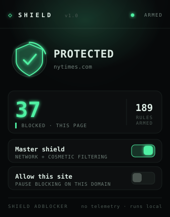

# Shield AdBlocker

A fast, private, **Manifest V3** ad and tracker blocker for Chromium browsers
(Chrome, Edge, Brave, Opera). It blocks ads at the **network layer** and hides
leftover ad slots with **cosmetic filtering** — with a deliberately small
permission footprint, no remote code, and no data collection.

> Built as a modern, security-hardened rewrite of the classic
> "build your own adblocker" tutorial — upgraded from the deprecated Manifest V2
> `webRequest` approach to MV3 `declarativeNetRequest`.

<p align="center">
  
</p>

---

## Features

- **Network-level blocking** of 180+ well-known ad/tracker networks
  (Google Ads, DoubleClick, Taboola, Outbrain, Criteo, Amazon Ads, analytics
  beacons, and more) via `declarativeNetRequest`.
- **Cosmetic filtering** — collapses ad containers and sponsored slots, with
  generic rules plus tuned selectors for YouTube, Reddit, LinkedIn, X, Facebook.
- **Per-site allowlist** — pause blocking on any site you want to support.
- **Global on/off** toggle from the popup.
- **Real "blocked on this page" counter** (uses the DNR feedback API).
- **Stealth-minded** — see [Stealth & detection](#stealth--detection).
- **Privacy by design** — zero telemetry, zero network requests of its own,
  everything runs locally. See [PRIVACY.md](PRIVACY.md).

## Install (load unpacked)

1. Open `chrome://extensions` (or `edge://extensions`, `brave://extensions`).
2. Enable **Developer mode** (top-right).
3. Click **Load unpacked** and select this folder.
4. Pin the 🛡️ icon and you're set.

Full steps with screenshots-worthy detail in [docs/INSTALL.md](docs/INSTALL.md).

## Usage

Click the toolbar icon:

| Control | What it does |
| --- | --- |
| **Blocking** | Master on/off switch for the whole extension. |
| **Allow this site** | Adds the current domain to the allowlist (blocking paused there). |
| **blocked on this page** | Number of requests blocked on the active tab. |
| **block rules active** | Number of network rules currently loaded. |

## How it works

```
                       ┌──────────────────────────┐
   Web request  ─────▶ │ declarativeNetRequest     │ ──▶ blocked (ad/tracker)
                       │ static ruleset (network)  │ ──▶ allowed (everything else)
                       └──────────────────────────┘
                                   ▲
   allowlist (per-site) ───────────┘  (high-priority session "allow" rules)

   Page DOM    ─────▶  content script injects CSS to collapse ad slots
```

Details in [docs/ARCHITECTURE.md](docs/ARCHITECTURE.md).

## Stealth & detection

The network blocking runs **below** page JavaScript: a blocked ad request looks
to the page like an ordinary network failure, and the page cannot enumerate the
extension's rules. The cosmetic layer runs in the content script's **isolated
world**, sets **no extension-identifying globals or attributes** on the page, and
**collapses** elements with CSS rather than ripping nodes out.

**Honest caveat:** no blocker is truly undetectable. Determined anti-adblock
walls can still infer that an element was hidden or a request failed. This
extension *minimizes* its fingerprint; it does not claim invisibility.

## Security

- Minimal permissions, strict CSP, no `eval`, no `innerHTML` of dynamic data,
  no remote code, no network calls of its own.
- The service worker only accepts messages from its **own** extension pages and
  validates every input.

Full threat model in [docs/SECURITY.md](docs/SECURITY.md).

## Limitations

- The bundled list (180+ networks) covers **common** ad/tracker domains, not the
  full breadth of EasyList. It is easy to extend — add entries to
  [`rules/ad-domains.txt`](rules/ad-domains.txt) and selectors to
  [`src/content/selectors.js`](src/content/selectors.js).
- "Block every ad on every site" and "undetectable" are best-effort goals, not
  guarantees — see the caveats above.
- Chromium only (MV3). Firefox is not targeted in this build.

## Updating the blocklist

The blocklist is generated, not hand-edited. Add domains to
[`rules/ad-domains.txt`](rules/ad-domains.txt) (one per line) and regenerate:

```bash
npm run build:rules     # rebuilds rules/network-rules.json from ad-domains.txt
npm run lint            # validates JSON + lints JS (also runs in CI)
```

`npm run lint:json` checks that `network-rules.json` is valid and **in sync**
with the source list — CI fails if you edit one without rebuilding.

## Project layout

```
manifest.json            MV3 manifest
rules/ad-domains.txt      blocklist source (one domain per line)
rules/network-rules.json  generated declarativeNetRequest static blocklist
scripts/build-rules.mjs   compiles ad-domains.txt -> network-rules.json
scripts/validate-rules.mjs CI guard: JSON valid + in sync
src/background.js         service worker (ruleset toggle, allowlist, messaging)
src/content/selectors.js  static cosmetic selectors
src/content/cosmetic.js   cosmetic filtering engine
src/popup/                popup UI (html/css/js)
icons/                    extension icons
docs/                     install, architecture, security, screenshot
.github/workflows/        CI (lint)
```

## Contributing

See [CONTRIBUTING.md](CONTRIBUTING.md).

## License

[MIT](LICENSE)
